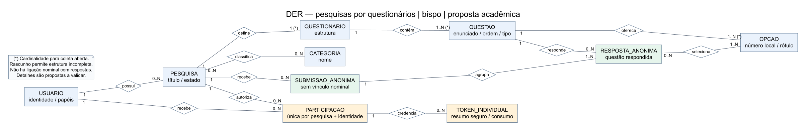

# Modelo conceitual — pesquisas por questionários

Proposta acadêmica do repositório bispo, derivada do levantamento das issues
[#1](https://github.com/Fatec-Extensao/pi-ads-2026-1-bispo/issues/1),
[#2](https://github.com/Fatec-Extensao/pi-ads-2026-1-bispo/issues/2) e
[#3](https://github.com/Fatec-Extensao/pi-ads-2026-1-bispo/issues/3).
O tema está documentado; as escolhas detalhadas abaixo são propostas para a
versão demonstrativa, não decisões validadas pelo professor ou responsável.

[PNG exigido na #3](./modelo-conceitual.png) · [SVG vetorial editável](./modelo-conceitual.svg)
· [Modelo lógico e 3FN](./modelo-logico.md)

O diagrama usa entidades retangulares e relacionamentos em losangos. As
cardinalidades nos extremos dizem quantas ocorrências daquela entidade podem
participar do relacionamento com uma ocorrência da outra. Foi exportado pelo
Graphviz, via `@viz-js/viz`, a partir da fonte DOT editável abaixo; a versão PNG
foi rasterizada do SVG. Não reutiliza diagramas de outro repositório.

## Entidades e relacionamentos

| Entidade | Identificação e conteúdo conceitual |
| --- | --- |
| Usuario | Identidade de elegibilidade/gestão e papéis; método de verificação pendente. |
| Pesquisa | Identificação, título, proprietário e estado de coleta. |
| Categoria | Identificação e nome; classificação proposta N:M. |
| Questionario | Estrutura única de uma pesquisa nesta versão. |
| Questao | Enunciado, ordem, tipo fechado e obrigatoriedade. |
| Opcao | Número local na questão e rótulo. |
| Participacao | Autorização única por pesquisa/identidade, com estado de finalização. |
| TokenIndividual | Resumo da credencial individual e consumo; sem prazo presumido. |
| SubmissaoAnonima | Conjunto anônimo de respostas de um preenchimento, vinculado à pesquisa. |
| RespostaAnonima | Resposta de uma submissão a uma questão. |

| Relacionamento | Cardinalidade proposta e regra |
| --- | --- |
| Usuario possui Pesquisa | Um proprietário por pesquisa; usuário possui 0..N pesquisas. |
| Pesquisa classifica Categoria | 0..N de ambos os lados (N:M). |
| Pesquisa define Questionario | Um questionário por pesquisa apta à coleta; em rascunho, 0..1. |
| Questionario contém Questao | 1..N para coleta; durante montagem, 0..N. |
| Questao oferece Opcao | 1..N para coleta nesta versão fechada; durante montagem, 0..N. |
| Usuario recebe Participacao | Uma identidade por participação; identidade tem 0..N autorizações. |
| Pesquisa autoriza Participacao | Uma pesquisa por participação; 0..N participações. Unicidade do par pesquisa/identidade. |
| Participacao credencia TokenIndividual | Um token pertence a uma participação; 0..N tokens por participação. Reemissão/revogação não implementadas. |
| Pesquisa recebe SubmissaoAnonima | Uma pesquisa por submissão; 0..N submissões por pesquisa. |
| SubmissaoAnonima agrupa RespostaAnonima | 1..N respostas em submissão finalizada. |
| Questao recebe RespostaAnonima | Uma questão por resposta; 0..N respostas por questão. |
| RespostaAnonima seleciona Opcao | 1..N opções escolhidas; opção participa de 0..N respostas (N:M); seleção única limita a uma opção. |

**Não existe relacionamento entre Participacao/TokenIndividual e
SubmissaoAnonima/RespostaAnonima.** A separação evita vínculo nominal direto,
mas não garante anonimato absoluto: serviço, logs, transações, backups, conteúdo
e grupos pequenos podem permitir correlação. A função conhece o token e as
respostas durante o pedido; não persiste esse vínculo.

## Delimitações da demonstração

- Um questionário por pesquisa; categorias N:M.
- Questões fechadas de seleção única ou múltipla, com obrigatoriedade configurável.
- Ao menos uma resposta por submissão; questão opcional não respondida é omitida.
- Rascunho → aberta → encerrada, sem retorno; estrutura congelada após abertura.
- `usuario.identificador` é apenas chave fictícia de elegibilidade nos testes;
  não resolve como pessoas reais serão verificadas.
- Sem expiração de token ou canal de relatório; sem política de retenção definida.

Essas escolhas foram necessárias para um protótipo testável. Não são apresentadas
como requisitos oficiais nem substituem as pendências de validação registradas
em [Engenharia de Software](../engenharia-software/requisitos.md).

## Fonte editável para exportação

```dot
graph DER {
  graph [rankdir=LR, bgcolor="white", pad="0.35", nodesep="0.35", ranksep="0.9", fontname="Arial", label="DER — pesquisas por questionários | bispo | proposta acadêmica", labelloc=t, fontsize=24];
  node [shape=box, style=filled, fillcolor="#eaf2fc", color="#536d8a", fontname="Arial", fontsize=16, margin="0.18,0.12"];
  edge [color="#475569", fontname="Arial", fontsize=13, labeldistance=2];
  Usuario [label="USUARIO\nidentidade / papéis"];
  Pesquisa [label="PESQUISA\ntítulo / estado"];
  Categoria [label="CATEGORIA\nnome"];
  Questionario [label="QUESTIONARIO\nestrutura"];
  Questao [label="QUESTAO\nenunciado / ordem / tipo"];
  Opcao [label="OPCAO\nnúmero local / rótulo"];
  Participacao [label="PARTICIPACAO\núnica por pesquisa + identidade", fillcolor="#fff2d9"];
  Token [label="TOKEN_INDIVIDUAL\nresumo seguro / consumo", fillcolor="#fff2d9"];
  Submissao [label="SUBMISSAO_ANONIMA\nsem vínculo nominal", fillcolor="#e6f5ec"];
  Resposta [label="RESPOSTA_ANONIMA\nquestão respondida", fillcolor="#e6f5ec"];
  node [shape=diamond, fillcolor="#ffffff", fontsize=13, margin="0.05,0.03"];
  possui; classifica; define; contem [label="contém"]; oferece;
  recebeA [label="recebe"]; autoriza; credencia;
  recebeS [label="recebe"]; agrupa; responde; seleciona;
  Usuario -- possui [taillabel="1"]; possui -- Pesquisa [headlabel="0..N"];
  Pesquisa -- classifica [taillabel="0..N"]; classifica -- Categoria [headlabel="0..N"];
  Pesquisa -- define [taillabel="1"]; define -- Questionario [headlabel="1 (*)"];
  Questionario -- contem [taillabel="1"]; contem -- Questao [headlabel="1..N (*)"];
  Questao -- oferece [taillabel="1"]; oferece -- Opcao [headlabel="1..N (*)"];
  Usuario -- recebeA [taillabel="1"]; recebeA -- Participacao [headlabel="0..N"];
  Pesquisa -- autoriza [taillabel="1"]; autoriza -- Participacao [headlabel="0..N"];
  Participacao -- credencia [taillabel="1"]; credencia -- Token [headlabel="0..N"];
  Pesquisa -- recebeS [taillabel="1"]; recebeS -- Submissao [headlabel="0..N"];
  Submissao -- agrupa [taillabel="1"]; agrupa -- Resposta [headlabel="1..N"];
  Questao -- responde [taillabel="1"]; responde -- Resposta [headlabel="0..N"];
  Resposta -- seleciona [taillabel="0..N"]; seleciona -- Opcao [headlabel="1..N"];
  Nota [shape=note, fontsize=14, label="(*) Cardinalidade para coleta aberta.\nRascunho permite estrutura incompleta.\nNão há ligação nominal com respostas.\nDetalhes são propostas a validar.", fillcolor="#f8fafc"];
}
```

[Voltar para Banco de Dados](./README.md)
