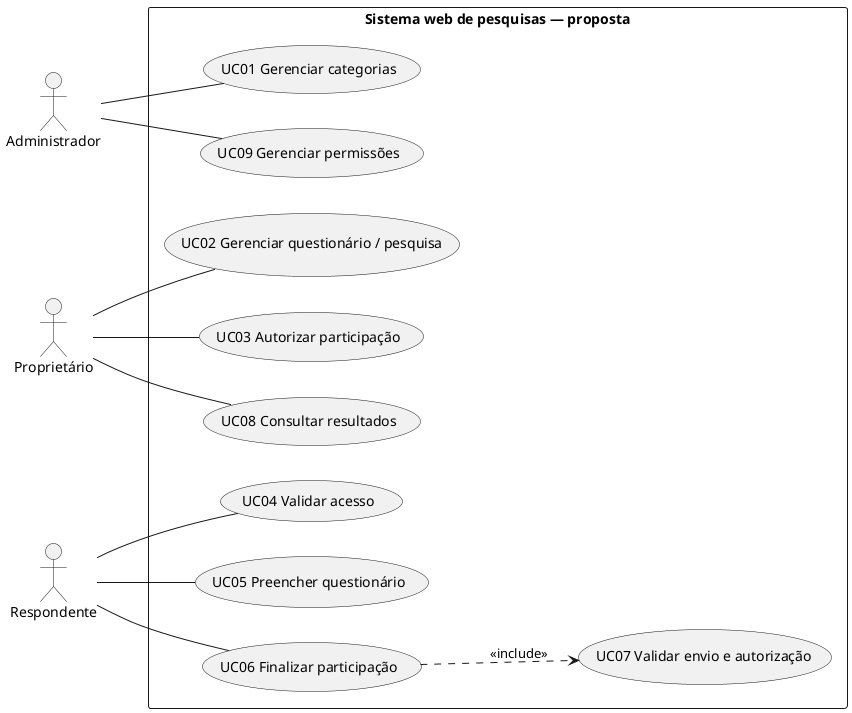
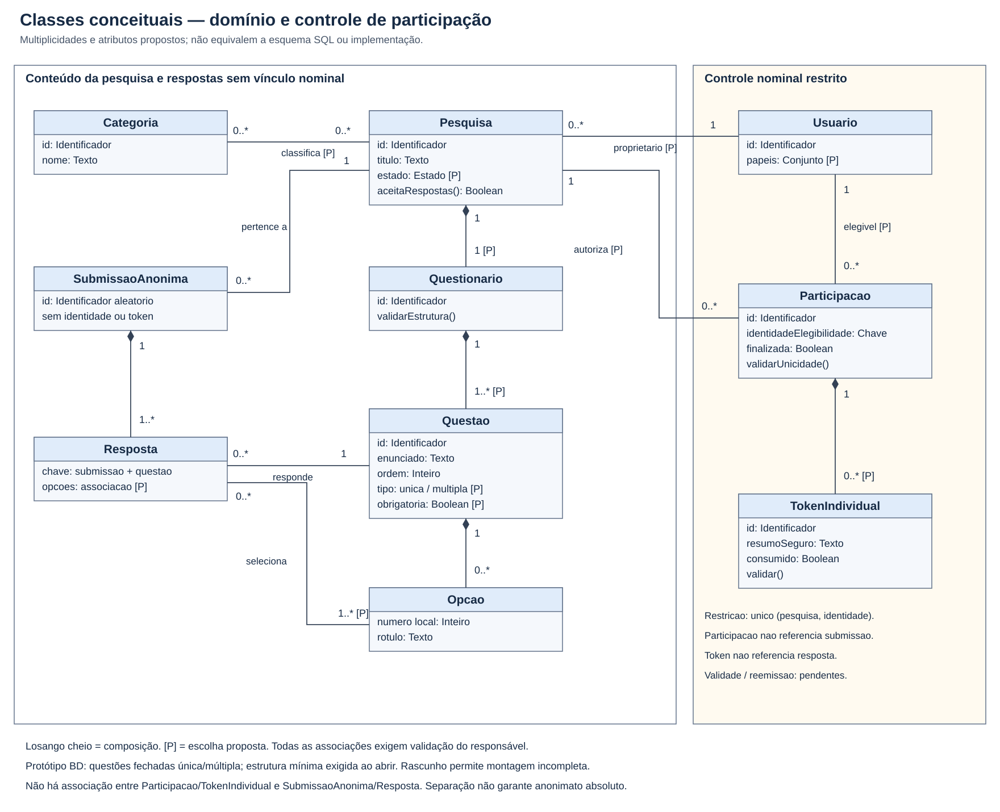
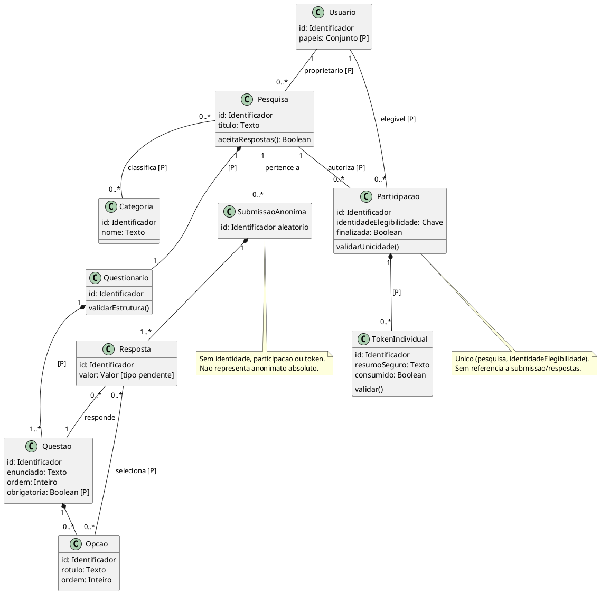
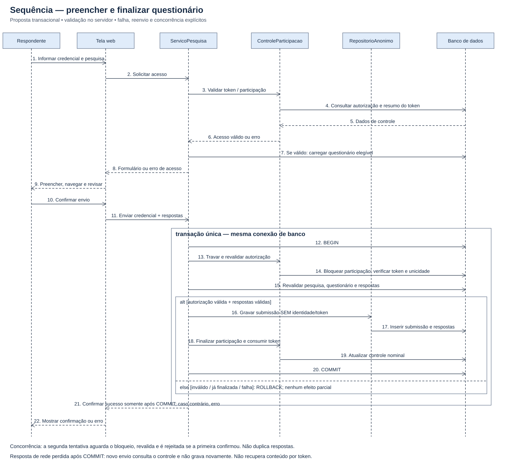
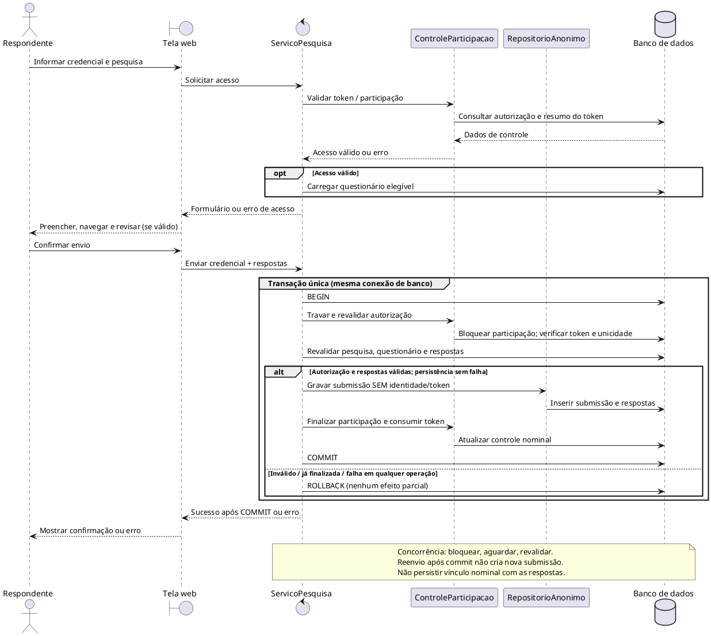

# Especificação UML — proposta para revisão

> Base: levantamento documental do repositório bispo, 15/10/2026.
> As escolhas detalhadas são propostas, não decisões oficiais nem código pronto.

Esta entrega atende ao conteúdo solicitado nas [issues #1](https://github.com/Fatec-Extensao/pi-ads-2026-1-bispo/issues/1)
e [#2](https://github.com/Fatec-Extensao/pi-ads-2026-1-bispo/issues/2).
Fontes, requisitos, fluxos de casos de uso e lacunas estão em
[requisitos.md](../requisitos.md). Não existe esquema SQL neste repositório para
alegar compatibilidade já validada. O diagrama de classes é conceitual.

## Artefatos e edição

| Diagrama | Imagem e fonte vetorial editável | Fonte textual |
| --- | --- | --- |
| Casos de uso | [casos-de-uso.svg](./casos-de-uso.svg) | Bloco PlantUML abaixo |
| Classes | [classes.svg](./classes.svg) | Bloco PlantUML abaixo |
| Sequência | [sequencia.svg](./sequencia.svg) | Bloco PlantUML abaixo |

SVG é um formato de imagem permitido e pode ser editado como XML ou em editor
vetorial. Os blocos PlantUML oferecem uma representação textual alternativa
editável, para colar em ferramenta compatível; o layout gerado por ela pode diferir
do SVG. Os SVGs foram desenhados diretamente, não exportados pelo PlantUML.
Não foram incluídos formatos de documento proibidos pelo README.

## Casos de uso

UC01/UC09 propõem responsabilidades do administrador; UC02/UC03/UC08, do
proprietário; UC04/UC05/UC06, do respondente. UC06 inclui UC07 obrigatoriamente
para evitar confiar apenas na validação inicial ou na interface.
Consultas de resultados estão sujeitas a autorização e política de divulgação.

## Classes conceituais

| Classe | Responsabilidade | Rastreabilidade |
| --- | --- | --- |
| Usuario | Representar identidade de gestão/elegibilidade no controle restrito; papéis a validar. | RF06, RF08, RF11 |
| Pesquisa | Reunir propósito, proprietário, classificação e elegibilidade da coleta. | RF01, RF05, RF06, RN07 |
| Categoria | Classificar pesquisas. | RF05, issue #3 |
| Questionario | Organizar a estrutura apresentada na pesquisa. | RF01, RN02, RN08 |
| Questao | Representar enunciado, ordem e eventual obrigatoriedade. | RF01, RF03 |
| Opcao | Representar alternativa de questão fechada. | RF01, issue #3 |
| Participacao | Controlar autorização e unicidade nominal por pesquisa. | RF07, RF08, RN03 |
| TokenIndividual | Representar credencial individual por resumo seguro e estado de consumo. | RF07, RN04 |
| SubmissaoAnonima | Agrupar respostas de um preenchimento, sem FK nominal. | RF09, RN05 |
| Resposta | Registrar conteúdo referente a uma questão e suas opções quando aplicáveis. | RF03, RF09 |

As multiplicidades 1:1 Pesquisa–Questionario, 1:N Questionario–Questao e N:M
Pesquisa–Categoria são **propostas**: não há documento do colega que as fixe.
Questões sem opções permitem discussão de tipos abertos, sem defini-los como
escopo confirmado. A associação Resposta–Opcao é 0..*: seleção simples ou múltipla
precisa ser decidida por tipo de questão. A implementação deve validar que questão
e opções pertencem ao questionário da pesquisa da submissão.

Usuario–Participacao abstrai a identidade de elegibilidade; não determina login
por conta cadastrada, matrícula, e-mail ou outro identificador. A chave única é o
par pesquisa/identidade de elegibilidade, e não apenas o token.
Participacao–TokenIndividual permite histórico de credenciais como proposta; a
quantidade de tokens ativos e as regras de reemissão são pendentes.

Composição é indicada por losango cheio. Não há associação entre os objetos
nominais Participacao/TokenIndividual e SubmissaoAnonima/Resposta. Submissões
podem ser correlacionadas por conteúdo mesmo sem esse vínculo: os limites estão
em RNF01 e na seção de anonimato dos requisitos.

## Sequência de preenchimento e finalização

As classes técnicas ServicoPesquisa, ControleParticipacao e RepositorioAnonimo
representam responsabilidades de uma arquitetura proposta. Não significam que
backend ou autenticação já existam. Os dois repositórios usam **a mesma transação
e conexão de banco**, não bancos independentes sem coordenação.

1. O respondente informa a credencial. O serviço valida a autorização e carrega
   o questionário se houver acesso. Erro de acesso impede o preenchimento.
2. A tela permite preencher, avançar/voltar e revisar. Validação de interface
   melhora a experiência; o servidor continua responsável pela validação final.
3. Ao finalizar, o serviço inicia transação, bloqueia a participação e revalida
   token, pesquisa, unicidade, versão/estrutura e respostas. A verificação da
   pesquisa deve permanecer válida até o commit por bloqueio ou controle equivalente.
4. Grava submissão/respostas sem identificadores nominais e finaliza a participação,
   consumindo o token na mesma transação. Só confirma sucesso após commit.
5. Entrada inválida, token consumido, participação já finalizada ou falha de
   persistência levam a rollback. Não há resposta parcial nem token consumido
   sem respostas confirmadas.
6. Dois envios concorrentes para a mesma participação são serializados: após o
   primeiro commit, o segundo revalida e é rejeitado. A unicidade por identidade
   também deve ser imposta na criação das autorizações para impedir contorno com
   duas participações e tokens diferentes.
7. Se o commit ocorrer e a resposta de rede se perder, reenvio verifica o controle
   finalizado e não grava de novo. Pode informar que a participação foi concluída,
   mas não recuperar conteúdo anônimo por token.

## Invariantes e critérios de revisão

| Cenário a testar na futura implementação | Resultado esperado |
| --- | --- |
| Token inválido ou de outra pesquisa | Não abre formulário nem grava respostas. |
| Resposta para questão/opção de outro questionário | Rejeita envio completo. |
| Falha após inserir respostas, antes de consumir token | Rollback das respostas; participação ainda disponível. |
| Falha após consumir token, antes de commit | Rollback de todos os efeitos. |
| Duas finalizações concorrentes da mesma participação | No máximo um commit com respostas; outra tentativa rejeitada. |
| Tentativa de criar duas autorizações para a mesma identidade/pesquisa | Unicidade impede duplicação. |
| Consulta de resultados por gestor sem autorização | Acesso negado. |
| Revisão de esquema, logs e payloads | Nenhum vínculo nominal persistido com submissão/respostas. |

Esses cenários são critérios futuros, **não testes executados**. A verificação
executada nesta entrega é documental e visual, registrada em
[verificacao.md](../verificacao.md). Validar as lacunas antes de declarar as issues
concluídas. Não foi alterado o banco de dados ou código da aplicação.

[Voltar para Engenharia de Software II](../README.md)
