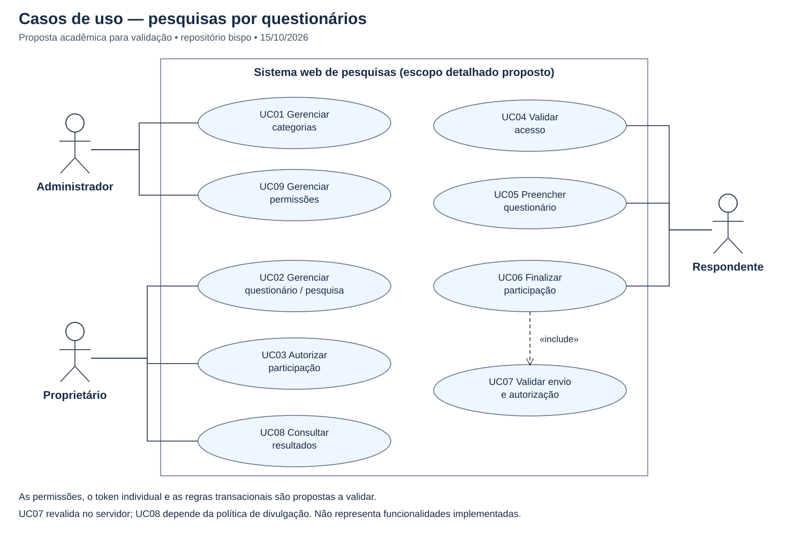

# Levantamento de requisitos — sistema de pesquisas por questionários

> Versão acadêmica para revisão, em 15/10/2026. Não representa implementação nem
> validação pelo responsável. O levantamento foi feito por análise documental;
> não houve entrevista nem acesso ao enunciado completo.

## Fontes e escopo efetivamente encontrado

Inspeção exclusiva de `Fatec-Extensao/pi-ads-2026-1-bispo`, na base
`eda7f823f5cad6f078b94421aa4a01ecf4afcb1a`. Foram lidos README principal,
árvore completa, documentos de 2026-1 e 2026-2 e todas as 12 issues com seus
checklists. Todas estavam abertas e sem comentários; requisitos e especificação
UML continham apenas avisos de documentação pendente. Nenhum requisito
detalhado preexistente foi removido. Não foram importados artefatos de outro PI.

| Fonte deste repositório | Evidência e consequência |
| --- | --- |
| [README principal](../../README.md) | Confirma pesquisas por questionários; declara escopo detalhado e integrantes pendentes. |
| [README 2026-2](../README.md) | Objetivos específicos e critérios acadêmicos pendentes. |
| [Issue #1](https://github.com/Fatec-Extensao/pi-ads-2026-1-bispo/issues/1) | Criação de questionários, autenticação de respondentes, relatórios, anonimato, tempo de resposta, responsividade e casos de uso PNG/SVG. |
| [Issue #2](https://github.com/Fatec-Extensao/pi-ads-2026-1-bispo/issues/2) | Classes Pesquisa, Questão, Resposta e Categoria; sequência de preenchimento e especificação técnica. |
| [Issue #3](https://github.com/Fatec-Extensao/pi-ads-2026-1-bispo/issues/3) | Pesquisa, Categoria, Questão, Opção e Resposta anônima como entidades esperadas. |
| [Issues #6–#8](https://github.com/Fatec-Extensao/pi-ads-2026-1-bispo/issues/6) | Telas institucional, login/acesso com senha, formulário e painel; HTML/CSS, acessibilidade, navegação e validação. |
| [Issue #11](https://github.com/Fatec-Extensao/pi-ads-2026-1-bispo/issues/11) | Minimização de dados, retenção e aviso de privacidade ainda a definir. |

Está confirmado o tema de questionários e uma interface web. O uso especificamente
institucional, os papéis de administração/propriedade e as regras detalhadas de
participação **não estão confirmados nas fontes**. A solicitação de preparação
destas entregas orienta uma proposta compatível com esse tema, identificada abaixo.
O amigo deverá validar as propostas antes de adotá-las como requisitos oficiais.

Legenda: **D** = documentado nas fontes (a descrição operacional é uma elaboração
para revisão); **P** = proposta desta entrega, dependente de validação.
Todos os requisitos abaixo são especificações esperadas, não funcionalidades prontas.

## Atores propostos

| Ator | Responsabilidade proposta | Origem |
| --- | --- | --- |
| Administrador | Gerenciar categorias e permissões de gestão. Não recebe acesso nominal às respostas. | P |
| Proprietário de pesquisa | Criar questionários próprios, configurar pesquisa, autorizar participações e consultar resultados permitidos. | P |
| Respondente | Autenticar/validar acesso, preencher e finalizar questionário. | D: #1, #2, #6 |

Administrador e proprietário são papéis, não necessariamente tipos exclusivos de
pessoa. O mecanismo de autenticação do gestor e a acumulação de papéis são pendentes.

## Requisitos funcionais e critérios de aceitação

| ID | Requisito | Origem | Critério de aceitação proposto |
| --- | --- | --- | --- |
| RF01 | Permitir criar e editar questionários com questões e opções. | D: #1, #3 | Um questionário com questões e opções válidas pode ser salvo; conteúdo inválido apresenta erro compreensível. |
| RF02 | Autenticar ou validar o acesso do respondente antes de responder. | D: #1, #6 | Credencial inválida não libera o formulário. A equivalência entre senha e token deverá ser validada. |
| RF03 | Apresentar questões, permitir avançar/voltar e validar campos obrigatórios antes do envio. | D: #2, #8 | A navegação mantém os dados durante o preenchimento; envio incompleto é rejeitado também no servidor. Persistência de rascunho entre sessões não está definida. |
| RF04 | Gerar resultados estatísticos da pesquisa. | D: #1, #5, #6 | Contagens por questão/opção correspondem às submissões finalizadas; respostas não finalizadas não entram nos resultados. Destinatários e canal são pendentes. |
| RF05 | Manter categorias e associá-las às pesquisas. | D: #2, #3; operação P | É possível classificar uma pesquisa; obrigatoriedade e quantidade de categorias por pesquisa precisam ser aprovadas. |
| RF06 | Restringir a gestão ao proprietário da pesquisa e às permissões atribuídas. | P | Tentativa de editar pesquisa alheia sem autorização é negada no servidor. Administrador não tem leitura irrestrita de respostas por consequência do papel. |
| RF07 | Emitir token individual vinculado a uma autorização de participação em uma pesquisa. | P | Token de outra pesquisa ou inexistente é rejeitado; só seu resumo seguro é persistido. Canal de distribuição e prazo de validade permanecem abertos. |
| RF08 | Permitir no máximo uma participação finalizada por respondente em cada pesquisa. | P | A mesma identidade de elegibilidade não consegue obter duas participações finais, mesmo com tokens distintos ou envios concorrentes. Definição/verificação dessa identidade é pendente. |
| RF09 | Registrar respostas sem vínculo persistente com identidade, participação ou token. | D: anonimato #1/#3; desenho P | Submissão anônima e suas respostas não possuem FK, token, IP, usuário ou identificador compartilhado com o controle nominal de participação. Ver RNF01. |
| RF10 | Finalizar atomicamente as respostas, a participação e o consumo do token. | P | Sucesso confirma todos os efeitos; falha desfaz todos. Reenvio/concorrência não cria segunda submissão. |
| RF11 | Administrar permissões e categorias. | P | Apenas gestor autorizado executa essas operações, com autorização verificada no servidor. |

## Requisitos não funcionais

| ID | Requisito verificável | Origem | Verificação e pendências |
| --- | --- | --- | --- |
| RNF01 | Minimizar dados identificáveis e separar o controle de participação do conteúdo das respostas. | D: #1, #11 | Revisar modelo, payloads e logs para evitar vínculo nominal; testar autorização do serviço. Não constitui anonimato absoluto. |
| RNF02 | Definir e medir tempo de resposta das operações principais. | D: #1 | Medir carregamento, acesso, envio e resultados. Meta, percentil, volume simultâneo, ambiente e rede serão acordados; nenhum SLA numérico foi inventado. |
| RNF03 | Oferecer interface responsiva com abordagem mobile-first. | D: #1, #7 | Validar telas pequenas e grandes sem perda de campos ou ações; matriz de dispositivos/navegadores pendente. |
| RNF04 | Oferecer rótulos, contraste, textos alternativos e uso por teclado. | D: #7; teclado P | Verificação manual de foco, leitura de erros e preenchimento por teclado; padrão e nível formal de conformidade pendentes. |
| RNF05 | Validar entradas e autorização no servidor, proteger credenciais e impedir registro de tokens em logs. | P, motivado por #10 | Testar acesso indevido, tokens inválidos e entradas malformadas; definir controles concretos na implementação. |
| RNF06 | Garantir integridade transacional e resistência a finalizações concorrentes. | P | Testar falha intermediária e dois envios simultâneos: nenhum efeito parcial e no máximo uma confirmação. |
| RNF07 | Definir retenção/exclusão e aviso de privacidade antes de operar com dados reais. | D: #11 | Política aprovada pelo responsável; prazos, base legal e eventual consentimento não são definidos nesta entrega. |

## Regras de negócio propostas

- **RN01 — Propriedade:** cada pesquisa tem um proprietário; concessões adicionais
  de gestão dependem de autorização explícita.
- **RN02 — Estrutura:** uma pesquisa usa um questionário com questões ordenadas;
  questões fechadas possuem opções. Tipos, obrigatoriedade e possibilidade de
  reutilização de questionários ainda exigem validação.
- **RN03 — Elegibilidade:** uma autorização de participação por par
  `(pesquisa, identidade de elegibilidade)`; a identidade fica exclusivamente no
  controle de participação. A regra não pode ser garantida só pelo token.
- **RN04 — Token:** token individual é credencial de acesso à participação,
  não identificador de resposta. Tokens válidos só podem finalizar a pesquisa
  associada; reemissão, revogação e validade precisam ser decididas.
- **RN05 — Separação:** a submissão anônima agrupa respostas de um preenchimento
  e pertence à pesquisa, mas não referencia participação ou token. É permitido
  relacionar respostas entre si dentro desse preenchimento; isso exige avaliar
  o risco de reidentificação pelo conjunto de respostas.
- **RN06 — Finalização:** sob transação, o serviço trava/revalida participação
  e token, valida questionário e respostas, grava a submissão anônima e consome
  a autorização/token. Confirma uma única vez; qualquer erro faz rollback.
- **RN07 — Pesquisa elegível:** o serviço verifica se a pesquisa aceita respostas
  na finalização. Ciclo de vida e regras de abertura/encerramento são pendentes.
- **RN08 — Mudanças:** o questionário respondido deve permanecer identificável
  e consistente; congelamento ou versionamento após início da coleta é decisão
  aberta, não implementação estabelecida.

## Casos de uso

O [SVG editável](./modelagem-uml/casos-de-uso.svg) usa atores, fronteira do sistema
e elipses UML. As associações indicam permissões propostas. `include` indica uma
etapa sempre executada dentro da finalização, não uma nova autenticação interativa.
O texto fonte reproduzível está na [especificação UML](./modelagem-uml/especificacao.md).

| Caso | Ator | Pré-condição | Fluxo e resultado | Alternativas principais |
| --- | --- | --- | --- | --- |
| UC01 Gerenciar categorias | Administrador | Gestão autorizada | Informa categoria, valida e salva. | Duplicidade/uso de categoria impedindo alteração: regra a validar. |
| UC02 Gerenciar questionário/pesquisa | Proprietário | Gestão autorizada | Define pesquisa, questões e opções; salva estrutura válida. | Pesquisa alheia ou mudança incompatível com coleta é rejeitada. Política de edição pendente. |
| UC03 Autorizar participação | Proprietário | Pesquisa própria e elegibilidade conhecida | Registra autorização única e emite token individual. | Duplicidade, identidade não verificada ou erro impedem emissão. Distribuição pendente. |
| UC04 Validar acesso | Respondente | Possui credencial | Verifica credencial e pesquisa; libera formulário. | Token inválido, consumido ou de outra pesquisa: rejeita. Expiração somente se política for aprovada. |
| UC05 Preencher questionário | Respondente | Acesso válido | Lê questões, seleciona respostas, navega e revisa. | Campo obrigatório ausente: indica erro; não finaliza. |
| UC06 Finalizar participação | Respondente | Formulário preenchido | Executa UC07, grava respostas anônimas e consome participação/token na mesma transação. | Concorrência/reenvio: rejeita sem gravar; falha: rollback e mensagem sem dados sensíveis. |
| UC07 Validar envio e autorização | Sistema, incluído por UC06 | Pedido de finalização | Revalida acesso, pesquisa, unicidade e consistência das respostas no servidor. | Nenhuma gravação se inválido. |
| UC08 Consultar resultados | Proprietário | Autorização e regras de divulgação aprovadas | Consulta agregações de submissões finalizadas. | Acesso indevido é negado; divulgação de grupos pequenos requer política. |
| UC09 Gerenciar permissões | Administrador | Administração autorizada | Concede/revoga permissões de gestão. | Não concede implicitamente identificação de respostas. |

## Limites de anonimato e decisões pendentes

A separação lógica evita um vínculo nominal direto, mas não garante anonimato
absoluto: correlação temporal, logs de infraestrutura, IP, backups, acesso
privilegiado, questões identificáveis e grupos pequenos podem revelar participantes.
Durante a finalização, o serviço conhece simultaneamente a autorização e as
respostas; a transação por si só não elimina essa possibilidade de correlação.
Não persistir esse vínculo; definir controles de logs, acesso e retenção com Segurança.

| Lacuna | Efeito e responsável pela validação |
| --- | --- |
| Enunciado completo e contexto institucional | Responsável/equipe e professor confirmam público, atores e objetivos. |
| Identidade de elegibilidade e login | Equipe define como garantir pessoa única sem colocar identidade nas respostas. |
| Senha versus token individual | Equipe esclarece a tela de acesso da #6 e o mecanismo da #1. |
| Validade, reemissão, revogação e distribuição do token | Responsável decide; não assumir expiração, e-mail ou outro canal. |
| Questionário, categorias e tipos de questão | Validar multiplicidades, reutilização, seleção simples/múltipla e obrigatoriedade. |
| Ciclo da pesquisa e edição durante coleta | Definir estados, abertura, encerramento e imutabilidade/versionamento. |
| Resultados | Definir público autorizado, canal, filtros, exportação e regra para grupos pequenos. |
| Metas de desempenho e disponibilidade | Acordar métricas, carga e critérios antes de testar aceitação. |
| Privacidade e retenção | Responsável com Segurança define política e limites de divulgação; nenhum prazo foi presumido. |

## Rastreabilidade das entregas

| Checklist real | Artefato desta proposta |
| --- | --- |
| #1: requisitos funcionais | RF01–RF11 e RN01–RN08 |
| #1: não funcionais | RNF01–RNF07, com metas pendentes explícitas |
| #1: casos de uso e imagem | UC01–UC09, SVG acima e fonte na especificação |
| #2: classes | Diagrama e justificativas na especificação UML |
| #2: sequência | Diagrama de preenchimento/finalização e alternativas na especificação UML |
| #2: imagens e especificação | Três SVGs editáveis e documentação Markdown |

Os checklists das issues continuam pendentes até revisão e validação acadêmica.
Não há evidência de implementação nem teste de execução do sistema.

[Voltar para Engenharia de Software II](./README.md)
